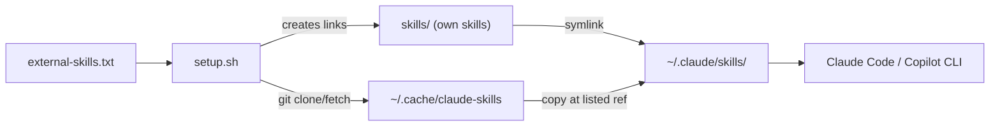

# claude-skills

A small collection of [Claude Code](https://claude.com/claude-code) skills, plus a script that installs them on any computer with a `git pull` and one command.

> Personal collection, published as-is. Issues and PRs are welcome, but I may not respond or merge them.

## learn-repo

Moved to its own repo: **[ruokai-lai/learn-repo](https://github.com/ruokai-lai/learn-repo)**, a tutor-style skill that teaches you an unfamiliar codebase. This repo installs it as an external skill.

## recall

**A long-term, searchable record of your past Claude Code sessions. Never used as context unless you ask.**

Claude Code keeps transcripts in `~/.claude/projects/` and may delete old ones. `recall` copies the useful part into its own local SQLite database and lets you search it later:

```
/recall cache invalidation            # numbered hits: date, project, title, snippet
                                      # you pick one, and only then is it loaded into the chat
```

- **Opt-in by design.** The skill has `disable-model-invocation`, so Claude cannot run it on its own. Searching shows you a list. A passage enters the conversation only when you choose it.
- **What it keeps:** your prompts, Claude's text replies, session titles, tool names and file paths. Not tool output or thinking. Secrets are redacted by pattern (API keys, tokens, `*_TOKEN=...`), which will not catch everything. The database lives at `~/.claude-history/history.db` (mode 600) and never leaves your machine.
- **Idempotent sync.** Every search syncs first. A session is re-read only if its file changed, so running it every hour adds nothing twice. Sessions Claude Code later deletes stay in the archive. `forget` removes one for good.
- **Search** is full-text and substring-based (so it works for Chinese too, and "agent" also matches "subagent"). It is keyword search, not semantic search.
- **Standalone CLI.** The skill wraps `skills/recall/recall.py` (Python 3.8+, standard library only):

```bash
python3 skills/recall/recall.py search "cache invalidation" --project my-repo --since 2026-10-01
python3 skills/recall/recall.py show 1 --turns 5
python3 skills/recall/recall.py list | stats | forget <n>
python3 skills/recall/recall.py install-job    # optional daily sync on macOS, so nothing is lost to cleanup
```

Tests: `cd skills/recall && python3 -m unittest -v test_recall`. Subagent transcripts are skipped unless you pass `--include-subagents` to `sync` and `--subagents` to `search`.

## Install

**Plugin (any computer, no clone):**

```
/plugin marketplace add ruokai-lai/claude-skills
/plugin install claude-skills@claude-skills
```

This installs all the skills in this repo. They are invoked as `/claude-skills:readme-from-repo` and `/claude-skills:recall`.

**Script (symlinks, so edits land in this repo):**

```bash
git clone https://github.com/ruokai-lai/claude-skills.git
cd claude-skills
./setup.sh            # add --dry-run first to see what it would do
```

Then restart Claude Code. Needs `git` and bash only.

`./setup.sh --target copilot` installs into `~/.copilot/skills/` for Copilot CLI instead.

## How it works



- **Own skills** (`skills/`) are symlinked, so edits made on any computer land in this repo.
- **External skills** (`external-skills.txt`) are fetched from their source repo at the listed ref and **copied**. Their files are not stored here. `setup.sh` replaces them on every run, so don't edit them in `~/.claude/skills/`. Clones are cached in `~/.cache/claude-skills` (or `$XDG_CACHE_HOME/claude-skills`).
- **External skills track `main`.** Replace `main` with a commit SHA to pin one, so upstream changes can't alter what gets installed.

`setup.sh` never overwrites a real folder in `~/.claude/skills/` for an own skill. It skips it and says so. Move the old copy into `skills/` first.

## Layout

| Path | Purpose |
|---|---|
| `skills/<name>/SKILL.md` | A skill I wrote. `evals/<case>/` holds its test cases (`prompt.md`, `case.yaml`, `graders/`). |
| `external-skills.txt` | One external skill per line: `name\|owner/repo\|path\|ref` |
| `.claude-plugin/` | `marketplace.json` and `plugin.json`, so the repo installs with `/plugin marketplace add` |
| `setup.sh` | Links own skills, fetches external ones |

## Day to day

| I want to | Do this |
|---|---|
| Add a skill I wrote | Put it in `skills/<name>/SKILL.md`, run `./setup.sh`, commit and push |
| Use someone else's skill | Add a line to `external-skills.txt`, run `./setup.sh` |
| Pin an external skill | Replace `main` in its line with a commit SHA |
| Update external skills | Run `./setup.sh` again (it re-fetches the listed ref) |
| Get changes from another computer | `git pull` (own skills update through the symlinks) |
| Remove a skill | Delete its folder or line, then delete the link in `~/.claude/skills/` |

## Skills

Mine:

| Skill | What it does |
|---|---|
| `readme-from-repo` | Reads a repo, then writes or updates its README from verified facts, with an approval gate. |
| `recall` | Searches an archive of your past Claude Code sessions. Opt-in only: loads nothing into context until you pick it. |

External (see `external-skills.txt`): `learn-repo` from [ruokai-lai/learn-repo](https://github.com/ruokai-lai/learn-repo), `grill-me`, `grilling` from [mattpocock/skills](https://github.com/mattpocock/skills); `hyperframes` (HTML to video) from [heygen-com/hyperframes](https://github.com/heygen-com/hyperframes).

## License and credits

[MIT](LICENSE). `readme-from-repo` adapts ideas and some wording from the `crafting-effective-readmes` skill in [softaworks/agent-toolkit](https://github.com/softaworks/agent-toolkit), also MIT. See [NOTICE](NOTICE).
