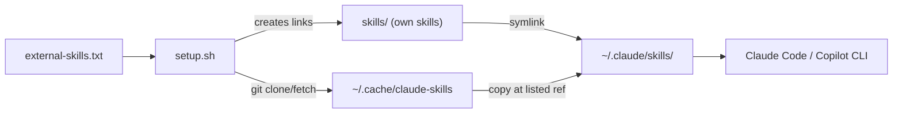

# claude-skills

A small collection of [Claude Code](https://claude.com/claude-code) skills, plus a script that installs them on any computer with a `git pull` and one command.

> Personal collection, published as-is. Issues and PRs are welcome, but I may not respond or merge them.

## Install

```bash
git clone https://github.com/ruokai-lai/claude-skills.git
cd claude-skills
./setup.sh            # add --dry-run first to see what it would do
```

Then restart Claude Code. Needs `git` and bash only.

`./setup.sh --target copilot` installs into `~/.copilot/skills/` for Copilot CLI instead.

## How it works



- **Own skills** (`skills/`) are symlinked, so edits made on any computer land in this repo.
- **External skills** (`external-skills.txt`) are fetched from their source repo at the listed ref and **copied**. Their files are not stored here. `setup.sh` replaces them on every run, so don't edit them in `~/.claude/skills/`. Clones are cached in `~/.cache/claude-skills` (or `$XDG_CACHE_HOME/claude-skills`).
- **External skills track `main`.** Replace `main` with a commit SHA to pin one, so upstream changes can't alter what gets installed.

`setup.sh` never overwrites a real folder in `~/.claude/skills/` for an own skill. It skips it and says so. Move the old copy into `skills/` first.

## Layout

| Path | Purpose |
|---|---|
| `skills/<name>/SKILL.md` | A skill I wrote. `evals/<case>/` holds its test cases (`prompt.md`, `case.yaml`, `graders/`). |
| `external-skills.txt` | One external skill per line: `name\|owner/repo\|path\|ref` |
| `setup.sh` | Links own skills, fetches external ones |

## Day to day

| I want to | Do this |
|---|---|
| Add a skill I wrote | Put it in `skills/<name>/SKILL.md`, run `./setup.sh`, commit and push |
| Use someone else's skill | Add a line to `external-skills.txt`, run `./setup.sh` |
| Pin an external skill | Replace `main` in its line with a commit SHA |
| Update external skills | Run `./setup.sh` again (it re-fetches the listed ref) |
| Get changes from another computer | `git pull` (own skills update through the symlinks) |
| Remove a skill | Delete its folder or line, then delete the link in `~/.claude/skills/` |

## Skills

Mine:

| Skill | What it does |
|---|---|
| `learn-repo` | Teaches a repo like a tutor: overview first, then a learn, quiz, apply, explain-back loop. Read-only. |
| `readme-from-repo` | Reads a repo, then writes or updates its README from verified facts, with an approval gate. |

External (see `external-skills.txt`): `grill-me`, `grilling` from [mattpocock/skills](https://github.com/mattpocock/skills).

## License and credits

[MIT](LICENSE). `readme-from-repo` adapts ideas and some wording from the `crafting-effective-readmes` skill in [softaworks/agent-toolkit](https://github.com/softaworks/agent-toolkit), also MIT. See [NOTICE](NOTICE).
